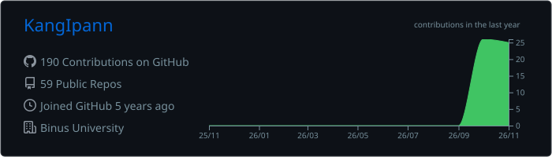
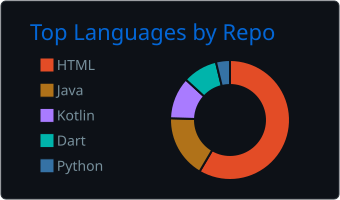
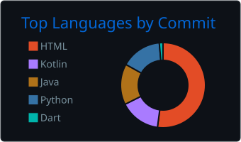
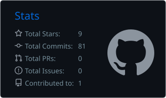
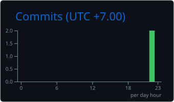

## 🚀 What I'm Working On

| Project | Description | Stack |
|---|---|---|
| 🤖 **AI Trading Agent** | BTC/USDT futures bot on Bybit (demo) using an LLM as its decision engine, with a custom reflection & memory system | `Python` `Claude API` `Bybit API` `Telegram` |
| 📊 **Strategy Tournament** | Backtesting system that pits 20 strategies (EMA, VWAP, etc.) against each other to find the strongest performer | `Python` `Pandas` |
| 🏃 **Running Event Registration** | Registration platform for a running event targeting ~400 participants | `Web` `In progress` |
| ☕ **Joko Coffee Digital** | Applying tech and PR to grow a real local F&B brand | `Business` `Branding` |

---

## 🛠️ Tech Stack

**Languages**

  

**Frameworks & Tools**

  

**Design & Content**

  
  

---

## 📈 GitHub Stats

  

  
  

  
  

  

---

## 💬 Let's Talk About

- 📱 Mobile & web development
- 🤖 AI agents and automation for small businesses
- 📉 Trading systems, backtesting, and the stock/crypto market
- ☕ Running an F&B business as a student
- 🗣️ Public relations, branding, and communication strategy
- 🎮 PC games

> 🤝 **Open to collaboration** — especially on projects where tech meets real-world business.

---

## 🌐 Connect With Me

  
  
  
  
  
  

<!-- ===================== FOOTER ===================== -->

  

